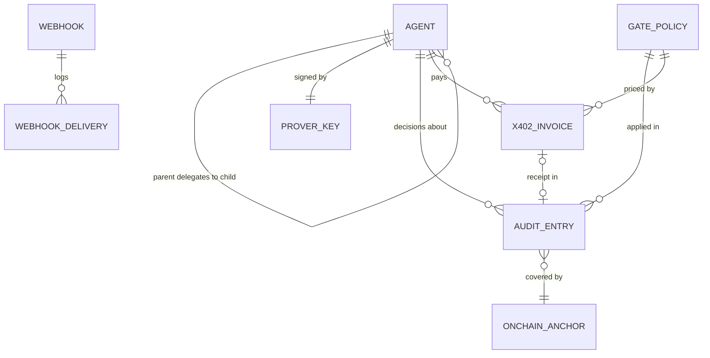

# Data model: AccordGate

<!-- Entities, relationships, ownership and invariants. Attributes live in the schema file:
     do not list them here. Term definitions go to CONTEXT.md via the domain-modeling skill. -->

Schema file: `server/types.ts` (server JSON store, `GatewayDatabase`); client copies in `src/types.ts`; Firestore shape in `firebase-blueprint.json`.

Two stores exist today and are not reconciled: the server JSON file (single tenant, no owner field) and Firestore (per workspace, owner-checked by `DRAFT_firestore.rules`). Decide in a slice which one is the source of truth.

## Entities
| Entity | What it is | Owned by |
| --- | --- | --- |
| Agent (`AgentRecord`) | An AI agent with a DID, Ed25519 key, agent card, spend limits and status | TODO: nobody on the server today; workspace owner in Firestore |
| Prover key (`proverKeys`) | The agent's Ed25519 private key, kept by the server to sign on its behalf | Server only |
| Gate policy (`GatePolicy`) | Rules for one protected endpoint: required ZKP predicates, price, caps, rate limit | TODO (same as Agent) |
| x402 invoice (`X402Invoice`) | A payment challenge for one call, later marked settled | TODO |
| Audit entry (`AuditEntry`) | One gateway decision, hash-chained to the previous entry | Append-only, nobody may edit |
| Webhook (`WebhookConfig`) and delivery log | Alert targets and their delivery results | TODO |
| On-chain anchor (`OnchainAnchorRecord`) | A Merkle/root hash of an audit range, with tx hash and mode | Append-only |

## Relationships

## Invariants (rules that must never break)
- Audit entries are append-only; each `prevHash` equals the previous `entryHash`; verification must detect any edit.
- A revoked agent never passes the gateway; revoking a parent with `cascadeRevoke` revokes every descendant.
- `dailySpentPlt` never exceeds `dailyLimitPlt`; one call never exceeds `perCallLimitPlt` or the policy's `maxPerCallPlt`.
- An invoice is settled at most once, and only after a real (or explicitly simulated) payment.
- Private keys are never returned by any API or written to logs.
- An anchor's `mode` always tells the truth: `simulated-payload` is never shown as on-chain.

## Ownership and access
See the role and permission table in `docs/SECURITY.md`.

## Conventions (decide once, apply to every table)
- [ ] Primary key type: TODO (demo uses prefixed strings like `agt_…`)
- [ ] Owner field on user data: TODO (`ownerUid` / `workspaceId` exist only in Firestore). The server is single-tenant: owners are the `OWNER_ACCOUNTS` wallet addresses and own everything; records carry no owner field.
- [x] `createdAt` / `updatedAt` as ISO strings in UTC
- [ ] Money: TODO — demo stores PLT/EURt and CCD amounts as JS `number` (float). Move to integer minor units before real payments.
- [x] Status fields are string unions (`AgentStatus`, invoice `status`, anchor `mode`); transitions: TODO
- [ ] Delete: TODO (webhooks are hard-deleted; agents are revoked, not deleted)
- [ ] Unique constraints: TODO (agent `did`, invoice `invoiceId`)
- [x] On-chain references store their network (`OnchainAnchorRecord.network`)
